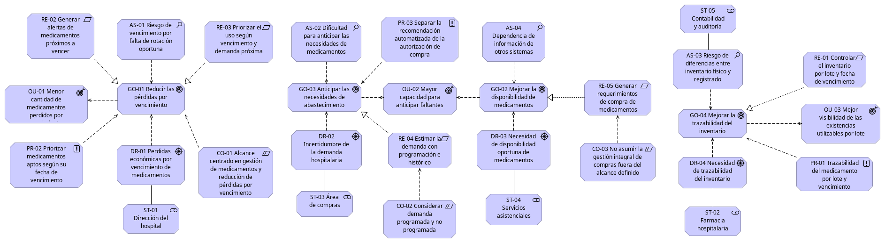
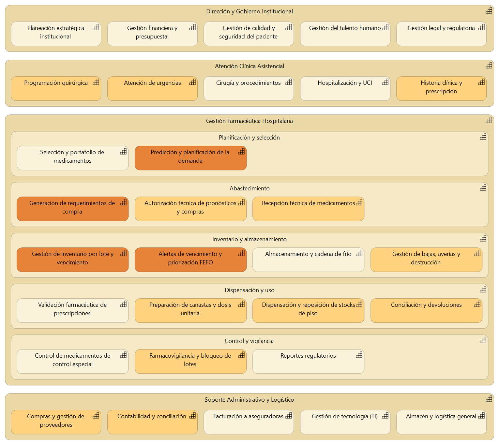
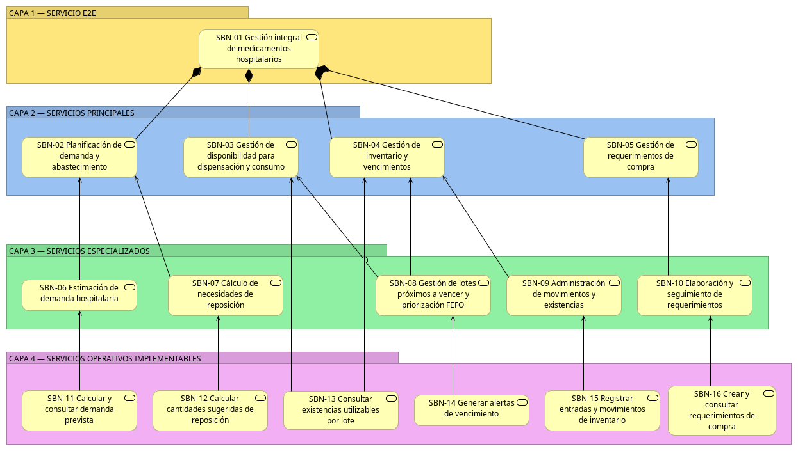
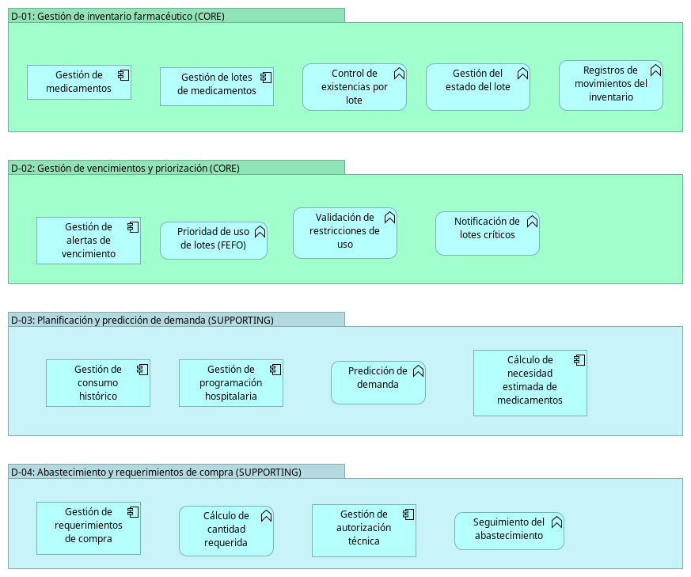
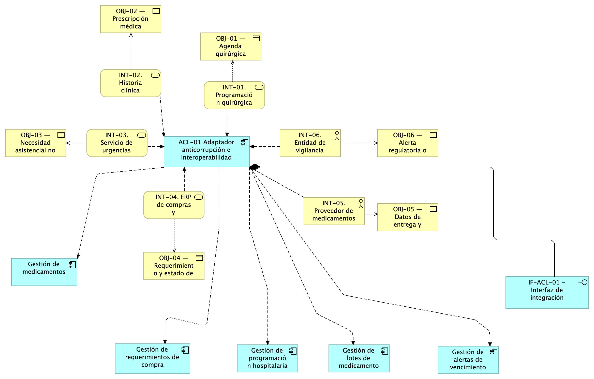
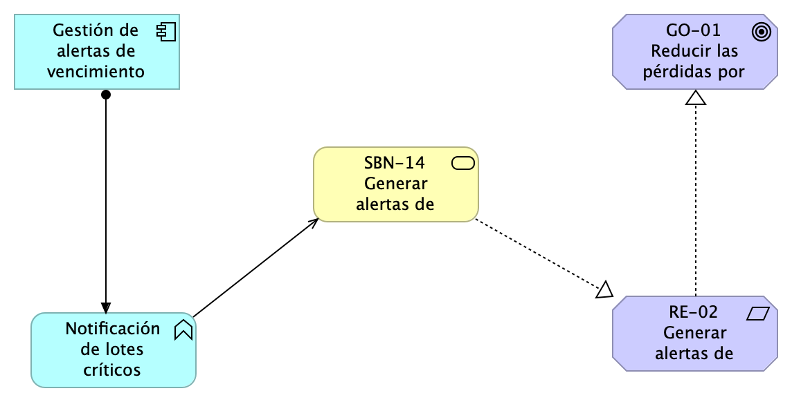
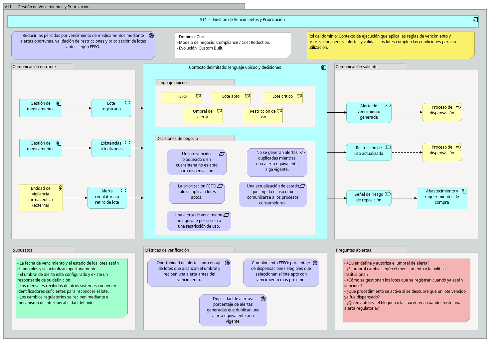

# Diseño de Arquitectura: Gestión de Medicamentos en Farmacia Hospitalaria

Este repositorio contiene el diseño de la arquitectura empresarial y de software para el proceso de gestión de medicamentos en la farmacia de un hospital, desarrollado con ArchiMate y siguiendo los principios de Domain-Driven Design (DDD).

## Tabla de Aportes del Equipo

| Integrante | Rol / Aportes Principales | Vistas Desarrolladas |
| :--- | :--- | :--- |
| **Salomé Fonseca.** | Entendimiento del negocio, Estrategia y Dominios | V2, V3 |
| **Pilar Mantilla** | Entendimiento del negocio, Estrategia y Dominios | V1, V4, V5 |
| **María Fernanda Muñoz** | Diseño Táctico (DDD), Agregados y Mapa de Contextos | V6, V7, V8 |
| **Diego Villegas** | Interoperabilidad, Trazabilidad y Canvas | V9, V10, V11 |

---

## Índice Navegable

1. [Contexto y Entrevista al Experto](#1-contexto-y-entrevista)
2. [Motivación](#2-motivación)
3. [Mapa de Capacidades y Proceso E2E](#3-mapa-de-capacidades-y-proceso-e2e)
4. [Descomposición de Servicios](#4-descomposición-de-servicios)
5. [Dominios y Lenguaje Ubicuo](#5-dominios-y-lenguaje-ubicuo)
6. [Agregados, Comandos y Eventos](#6-agregados-comandos-y-eventos)
7. [Mapa de Contextos e Interoperabilidad](#7-mapa-de-contextos-e-interoperabilidad)
8. [Bounded Context Canvas](#8-bounded-context-canvas)
9. [Decisiones y Supuestos](#9-decisiones-y-supuestos)

---

## 1. Contexto y Entrevista
El levantamiento de los requerimientos y la comprensión del negocio se realizó simulando una entrevista con un experto en operaciones de farmacia hospitalaria. 

* **Documento completo de la entrevista:** [Ver Evidencia de Entrevista](Entrevistas/Evidencia_Entrevista_Farmacia_Hospitalaria_Parcial3.docx)

---

## 2. Motivación

### V1 - Motivación del Negocio
Esta vista explica por qué existe la aplicación y cómo se alinea con los elementos estratégicos del hospital (metas, impulsores, restricciones).

* **Análisis y Justificación:** [Leer justificación completa de V1](<Vistas/V1/V1 — Motivación.md>)

---

## 3. Mapa de Capacidades y Proceso E2E

### V2 - Mapa de Capacidades Empresariales
Identifica las capacidades actuales del negocio y resalta aquellas que son impactadas directamente por la solución propuesta.

* **Análisis y Justificación:** [Leer justificación completa de V2](Vistas/V2/V2_Justificacion.md)

### V3 - Cadena de Valor y Proceso E2E
Muestra el flujo de valor y el proceso operativo de extremo a extremo, ubicando la aplicación en el ecosistema real de la farmacia.

* **Análisis y Justificación:** [Leer justificación completa de V3](Vistas/V3/V3_Justificacion.md)

---

## 4. Descomposición de Servicios

### V4 - Capas de Servicios (Contract First)
Descomposición funcional en capas de servicios. Define el alcance delimitando qué servicios serán automatizados/implementados y cuáles quedan por fuera.

* **Análisis y Justificación (Inclusión/Exclusión):** [Leer justificación de V4](<Vistas/V4/V4 — Descomposición de servicios.md>)

---

## 5. Dominios y Lenguaje Ubicuo

### V5 - DDD Estratégico (Dominios)
Extracción de clústeres del sistema y su clasificación estratégica (Core y Supporting domains).

* **Análisis y Justificación:** [Leer justificación de V5](<Vistas/V5/V5 — Dominios (DDD estratégico).md>)

---

## 6. Agregados, Comandos y Eventos

### V6 - DDD Táctico
Diseño interno de cada dominio detallando la Raíz de Agregación, sus comandos (acciones mutadoras) y sus eventos de dominio.

* **Análisis y Límites/Invariantes:** [Leer justificación de V6](<Vistas/V6/V6 - Agregados, Comandos y Eventos).md>)

### V7 - Lenguaje Ubicuo
Glosario estricto de términos compartidos entre los expertos del dominio y el equipo de desarrollo (ej. FEFO, Cuarentena, Dosis Unitaria).

* **Análisis y Definiciones:** [Leer justificación de V7](Vistas/V7/V7%20-%20Lenguaje%20Ubicuo.md)

---

## 7. Mapa de Contextos e Interoperabilidad

### V8 - Mapa de Contextos Delimitados
Relaciones y patrones de integración (Customer/Supplier, Conformist, ACL) entre los dominios internos de Farmacia y los sistemas externos del hospital.

* **Análisis de Interoperabilidad:** [Leer justificación de V8](Vistas/V8/V8%20-%20Mapa%20de%20Contextos.md)

### V9 - Interoperabilidad y Capa Anticorrupción
Mecanismo de interoperabilidad entre Farmacia y los sistemas externos del hospital, centralizado en un único componente de Capa Anticorrupción (ACL) que traduce y protege al dominio interno de los formatos de cada sistema externo.

* **Análisis de Interoperabilidad y Anticorrupción:** [Leer justificación de V9](Vistas/V9/V9_Interoperabilidad_anticorrupcion.md)

### V10 - Trazabilidad Vertical
Hilo de trazabilidad que conecta una meta estratégica del negocio con el componente de aplicación concreto que contribuye a cumplirla, atravesando las capas de Motivación, Negocio y Aplicación mediante relaciones de Realization, Serving y Assignment.

* **Análisis de Trazabilidad:** [Leer justificación de V10](Vistas/V10/V10_Trazabilidad_vertical.md)

---

## 8. Bounded Context Canvas

### V11 - Canvas del Contexto Principal
Bounded Context Canvas (plantilla ddd-crew) del dominio Core "Gestión de Vencimientos y Priorización", documentando en una sola página su clasificación estratégica, lenguaje ubicuo, decisiones de negocio, dependencias de entrada/salida y supuestos.

* **Análisis del Canvas:** [Leer justificación de V11](Vistas/V11/v11_Bouded_context_canvas.md)

---

## 9. Decisiones y Supuestos
*   **Archivos fuente:** Todo el modelo de ArchiMate se encuentra consolidado en un único archivo en la ruta `Modelo/Base`.
*   *(Aquí el equipo puede documentar otras decisiones arquitectónicas generales cuando finalicen el diseño).*
